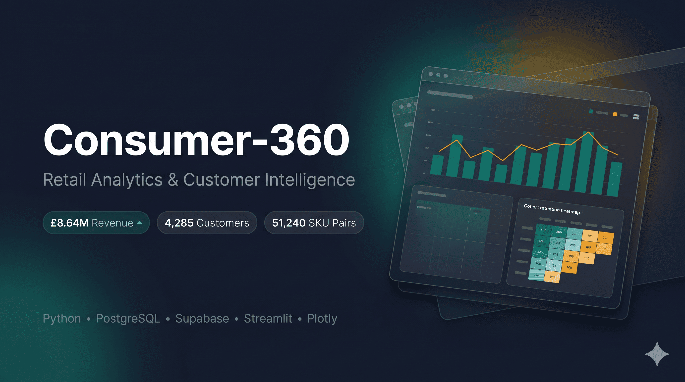
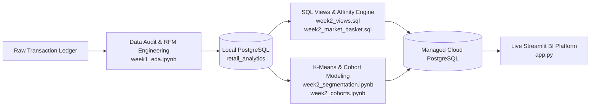

<div align="center">



# Consumer-360 Retail Analytics

**End-to-end customer intelligence pipeline, commercial strategy, and a live cloud BI dashboard**

[](https://consumer-360.streamlit.app/)
[](https://www.python.org/)
[](https://www.postgresql.org/)
[](https://plotly.com/)
[](https://scikit-learn.org/)
[](https://docs.astral.sh/uv/)
[](LICENSE)

*Bridging **data engineering and statistical modeling** with **commercial strategy and revenue optimization** across **399,568** retail transactions.*

[Executive Summary](#executive-summary) · [Recommendations](#business-impact--strategic-recommendations) · [Architecture](#technical-architecture) · [Data Model](#data-model-retail_analytics) · [Deep Dive](#analytical-deep-dive) · [Live App](#interactive-bi-modules) · [Repository](#repository-structure) · [Run Locally](#local-reproduction)

</div>

---

## Executive Summary

> [!NOTE]
> **Business problem:** Leadership lacked unified visibility into which customer tiers actually drive margin, when seasonal buyers churn, and which SKUs should be bundled. That limited retention targeting and merchandising ROI across **37** international markets.

| Commercial KPI | Verified Baseline | Analytical Takeaway |
| :--- | :--- | :--- |
| **Net Revenue** | **£8,639,657.21** | 13-month operating window (`2009-12` – `2010-12`) |
| **Order Volume** | **18,966 invoices** | **£455.53** AOV · **290.8 units/basket** (wholesale-heavy demand) |
| **Customer Base** | **4,285 buyers** | Top 10% (`429`) generate **59.79%** of revenue; top 20% (`857`) generate **73.38%** |
| **Catalog Breadth** | **4,008 SKUs** | **51,240** co-purchased product pairs (`pair_count >= 20`) |

---

## Business Impact & Strategic Recommendations

| Focus Area | Empirical Finding | Recommended Action |
| :--- | :--- | :--- |
| **VIP Retention** | **457 Champions** (`10.67%` of buyers) generate **£4,379,830.38** (**50.69%** of revenue) with `7.5d` average recency. | Prioritize white-glove retention: early Q4 stock allocation, volume rebates, and dedicated account outreach. |
| **Churn Recovery** | **398 At Risk** customers hold **£391,012.46** in historical spend (`144.4d` average recency, `2.3` orders). | Trigger automated win-back campaigns at the 90–120 day inactivity mark, before buyers slip into `Hibernating`. |
| **Seasonal Timing** | Cohort retention rebounds from **20.52%** (`M+1`) to **29.98%** (`M+11`); the `2009-12` cohort reaches **49.63%** at `M+11`. | Concentrate reactivation budgets on Q4 restocking windows instead of flat year-round discounting. |
| **Cross-Sell Bundling** | `WOODEN PICTURE FRAME WHITE FINISH` + `WOODEN FRAME ANTIQUE WHITE` co-occur in **554** baskets at **12.73x lift**. | Surface high-lift pairs as "Frequently Bought Together" cart add-ons and tiered bundle promotions. |

---

## Technical Architecture



### Key Engineering Decisions

| Decision | Why it matters |
| :--- | :--- |
| **SQL-side basket deduplication** | `week2_market_basket.sql` deduplicates `(invoice, stock_code)` in a CTE before the self-join, so repeated line items on one invoice never inflate support or lift. |
| **Skew-normalized clustering** | Retail spend is heavily right-skewed (`£455` AOV, wholesale buyers above `£300k`). `recency`, `frequency`, and `monetary` are log-transformed (`np.log1p`) and standardized (`StandardScaler`) before K-Means (`k=4`, silhouette `0.3331`). |
| **Indexed analytical warehouse** | Fact and dimension tables are indexed on `invoice_date`, `customer_id`, and `rfm_segment` for sub-second filtering and view aggregation. |
| **Resilient cloud connectivity** | The Streamlit layer uses `sqlalchemy.URL.create` over an IPv4-compatible database pooler, with `@st.cache_data` for fast, reliable cloud rendering. |

---

## Data Model (`retail_analytics`)

| Object | Type | Rows | Grain | Role in Pipeline |
| :--- | :--- | ---: | :--- | :--- |
| `cleaned_transactions` | Table | 399,568 | Invoice line | Audited, positive-revenue transaction ledger |
| `customer_rfm` | Table | 4,285 | Customer | Recency, frequency, monetary values and quartile scores |
| `customer_segments` | Table | 4,285 | Customer | RFM segment labels and K-Means cluster assignments |
| `cohort_retention` | Table | 91 | Cohort × Month | Monthly acquisition retention (`M+0` to `M+12`) |
| `product_affinity` | Table | 51,240 | SKU pair | Co-purchase counts, support, confidence, and lift |
| `vw_monthly_kpis` | View | 13 | Month | Monthly revenue, orders, customers, and AOV |
| `vw_country_performance` | View | 37 | Country | Geographic revenue and order distribution |
| `vw_rfm_segments` | View | 4,285 | Customer | Rule-based RFM segment rollups |

---

## Analytical Deep Dive

<details>
<summary><b>1. RFM & K-Means Segmentation Breakdown</b></summary>

<br/>

| RFM Segment | Customers | Customer Share | Total Revenue | Revenue Share | Avg Recency | Avg Frequency |
| :--- | ---: | ---: | ---: | ---: | ---: | ---: |
| **Champions** | 457 | 10.67% | £4,379,830.38 | **50.69%** | 7.5 d | 16.1 |
| **Loyal Customers** | 1,334 | 31.13% | £3,092,755.92 | **35.80%** | 56.7 d | 5.7 |
| **Hibernating / Lost** | 1,393 | 32.51% | £429,627.77 | 4.97% | 167.0 d | 1.5 |
| **At Risk** | 398 | 9.29% | £391,012.46 | 4.53% | 144.4 d | 2.3 |
| **Potential Loyalists** | 703 | 16.41% | £346,430.67 | 4.01% | 26.8 d | 1.4 |

- **K-Means validation (`k=4`):** **Cluster 3** (`762` customers: `456` Champions + `306` Loyalists) captures **£5,587,685.98** (`64.67%` of total revenue), averaging **£7,332.92** per customer.

</details>

<details>
<summary><b>2. Cohort Retention & Market Basket Benchmarks</b></summary>

<br/>

- **Cohort retention (`M+0` – `M+12`):** Average retention rises from **20.52%** (`M+1`) to **29.98%** (`M+11`), anchored by the `2009-12` cohort (`951` customers), which peaks at **49.63%** in `M+11`.
- **Top co-purchased SKU pairs (`pair_count >= 20`), ranked by shared baskets:**

| Product A | Product B | Shared Baskets | Lift |
| :--- | :--- | ---: | ---: |
| `RED HANGING HEART T-LIGHT HOLDER` | `WHITE HANGING HEART T-LIGHT HOLDER` | **722** | 4.56x |
| `SWEETHEART CERAMIC TRINKET BOX` | `STRAWBERRY CERAMIC TRINKET BOX` | **622** | 10.94x |
| `PACK OF 72 RETROSPOT CAKE CASES` | `60 TEATIME FAIRY CAKE CASES` | **601** | 6.59x |
| `WOODEN PICTURE FRAME WHITE FINISH` | `WOODEN FRAME ANTIQUE WHITE` | **554** | **12.73x** |
| `RED RETROSPOT JUMBO BAG` | `JUMBO BAG STRAWBERRY` | **549** | 6.96x |

</details>

---

## Interactive BI Modules

**[Open the live app](https://consumer-360.streamlit.app/)**

| Module | What you can do |
| :--- | :--- |
| **Executive Overview** | Dual-axis monthly net revenue and order volume trend, top 10 countries ranking, hourly order volume profile |
| **Customer Segmentation** | RFM revenue vs. headcount, K-Means cluster profiles, recency vs. monetary (log-scale) scatter plot, filtered CSV export |
| **Cohort Retention** | Annotated `M+0` to `M+12` retention heatmap and average retention trajectory |
| **Market Basket** | Live SKU keyword search with adjustable `Min Co-Purchased Baskets` and `Min Lift` sliders for bundle discovery |

---

## Repository Structure

```text
Consumer-360/
├── app.py                                  # Streamlit + Plotly dashboard (Supabase → local PostgreSQL → CSV fallback)
├── assets/
│   └── banner.png                          # Repository hero banner
├── data/
│   ├── processed/                          # Week 1–2 analytical exports
│   │   ├── cleaned_retail_week1.csv
│   │   ├── customer_rfm_week1.csv
│   │   ├── customer_segments_week2.csv
│   │   ├── cohort_retention_week2.csv
│   │   └── product_affinity_week2.csv
│   └── supabase_db/                        # Dashboard-ready tables (CSV copies of the database)
│       ├── retail_transactions.csv
│       ├── customer_segments.csv
│       ├── customer_rfm_metrics.csv
│       ├── cohort_retention.csv
│       └── product_bundles.csv
├── docs/
│   ├── Consumer360_Executive_Deck.pptx     # Executive presentation & churn watchlist
│   └── Consumer360ProjectReport.pdf        # Final project report (architecture & findings)
├── notebooks/
│   ├── week1_eda.ipynb                     # Data cleaning, EDA & RFM baseline
│   ├── week2_segmentation.ipynb            # RFM profiling & K-Means clustering
│   ├── week2_cohorts.ipynb                 # Monthly cohort retention analysis
│   └── consumer360_bi_row_standardization.ipynb  # BI table standardization for the dashboard
├── scripts/
│   └── run_etl.py                          # End-to-end ETL: clean → RFM/K-Means → load PostgreSQL
├── sql/
│   ├── week2_views.sql                     # Indexed KPI, geography & RFM views
│   └── week2_market_basket.sql             # Co-purchase support, confidence & lift
├── upload_to_postgres.ps1                  # Create tables & load CSVs into local PostgreSQL / Supabase
├── upload_to_postgres.bat                  # CMD wrapper for upload_to_postgres.ps1
├── .devcontainer/                          # GitHub Codespaces / VS Code dev container
├── .env.example                            # Environment variable template
├── .gitignore
├── LICENSE                                 # MIT License
├── README.md
├── pyproject.toml                          # uv dependency specification
├── requirements.txt                        # Cloud deployment dependency manifest
└── uv.lock                                 # Locked dependency tree
```

> [!NOTE]
> `data/raw/` (the source ledger) is git-ignored and not in the repository. The ETL script expects `data/raw/online_retail_II_2009-10.csv`.

---

## Local Reproduction

```bash
# 1. Install dependencies
uv sync

# 2. Configure the environment from the template (keep .env untracked)
cp .env.example .env
#    ...then add your PostgreSQL and/or Supabase credentials

# 3. Launch the dashboard
uv run streamlit run app.py
```

The dashboard tries Supabase, then local PostgreSQL, then falls back to the bundled CSVs in `data/supabase_db/`, so it runs without a database.

<details>
<summary><b>Optional: rebuild or reload the database</b></summary>

<br/>

```bash
# Rebuild everything from the raw ledger
# (place online_retail_II_2009-10.csv in data/raw/ first)
uv run python scripts/run_etl.py --target local     # local | supabase | both

# Or load the bundled CSVs directly (Windows)
.\upload_to_postgres.ps1 -Target local              # local | supabase
```

</details>

For cloud deployment, add your database credentials to your hosting platform's **Secrets** manager rather than committing them.

---

## Author

**Riddhima**: [GitHub](https://github.com/Riddhis2226) · [LinkedIn](https://www.linkedin.com/in/riddhima-singh-a7383431a)

## License

Released under the [MIT License](LICENSE).